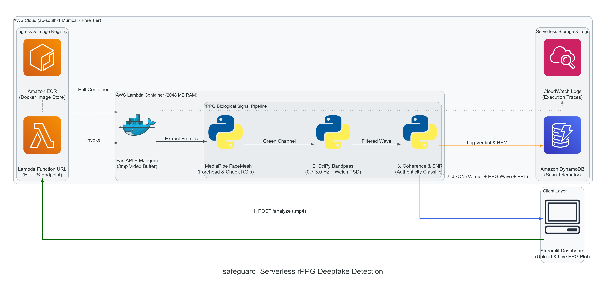

# SafeGuard

High-performance biological rPPG engine, multi-region spatial coherence verification, and zero-cost serverless deepfake detection.

SafeGuard bridges MediaPipe FaceMesh landmark tracking, green-channel hemoglobin chrominance extraction, and Welch's spectral power density analysis with a serverless AWS Lambda architecture. It provides real-time biological liveness verification and synthetic face detection via multi-ROI blood volume pulse extraction, cross-region phase correlation, and automated DynamoDB telemetry auditing.

---

## Table of Contents
- [Key Features](#key-features)
- [Architecture Overview](#architecture-overview)
- [Execution Flow](#execution-flow)
- [Prerequisites](#prerequisites)
- [Quickstart](#quickstart)
  - [1. Environment Setup](#1-environment-setup)
  - [2. Local Backend Execution](#2-local-backend-execution)
  - [3. Interactive Dashboard](#3-interactive-dashboard)
- [Usage Example](#usage-example)
  - [Direct rPPG Engine Analysis](#direct-rppg-engine-analysis)
  - [REST API Video Verification](#rest-api-video-verification)
- [Infrastructure & Deployment](#infrastructure--deployment)
  - [AWS CDK Serverless Stack](#aws-cdk-serverless-stack)
- [Testing](#testing)
- [CI / CD Pipelines](#ci--cd-pipelines)

---

## Key Features

- **Facial Landmark Mesh & Biological ROI Extraction**: Tracks 468+ facial landmarks using MediaPipe FaceMesh to isolate three biological regions of interest (Forehead, Left Cheek, and Right Cheek) with dynamic polygonal masking.
- **Green-Channel Hemoglobin Absorption Filtering**: Extracts the 540nm green light absorption profile from subcutaneous capillaries and isolates human cardiac pulse dynamics using a 3rd-order Butterworth bandpass filter ($0.7\text{ Hz} - 3.0\text{ Hz}$ / $42 - 180\text{ BPM}$).
- **Cross-Region Spatial Coherence Verification**: Computes Pearson correlation coefficients across independent anatomical facial sites. Authentic human biology exhibits high spatial coherence ($>0.55$), whereas synthetic generative models or face-swaps introduce uncorrelated pixel artifacts.
- **Spectral Power & Cardiac SNR (Welch's Method)**: Computes the Power Spectral Density (PSD) using Welch's periodogram to calculate peak cardiac frequency, estimated Beats Per Minute (BPM), and cardiac Signal-to-Noise Ratio (SNR in dB).
- **Zero-Cost Serverless Cloud Deployment**: Containerized AWS Lambda Docker image with built-in HTTPS Function URLs (bypassing API Gateway costs) and DynamoDB On-Demand for telemetry, designed within AWS Always-Free limits in `ap-south-1` (Mumbai).
- **Interactive Streamlit Biometric Dashboard**: Real-time visualization of synchronized facial pulse waveforms, cardiac frequency spectra, confidence scores, and deepfake verdicts.

---

## Architecture Overview



```plaintext
safeguard/
├── .github/
│   └── workflows/
│       ├── ci.yml                 # Linting, Docker build verification & pytest suite
│       └── deploy.yml             # AWS CDK deployment to AWS Lambda Function URL
├── assets/
│   └── architecture_diagram.png   # System architecture diagram
├── backend/                       # Containerized AWS Lambda (Core rPPG + AI Engine)
│   ├── Dockerfile                 # Packages OpenCV, MediaPipe, and SciPy for Lambda
│   ├── requirements.txt           # Python dependencies for the container
│   ├── rppg_engine.py             # ROI tracking, Butterworth filter, FFT, & Classifier
│   ├── app.py                     # FastAPI REST API + Mangum AWS Lambda handler
│   └── handler.py                 # AWS Lambda entrypoint alias
├── frontend/                      # Local/Hosted Interactive Dashboard
│   ├── dashboard.py               # Streamlit UI entrypoint
│   └── streamlit_app.py           # Interactive UI with live pulse & FFT graphs
└── infra/                         # AWS CDK Infrastructure-as-Code (ap-south-1)
    ├── app.py                     # CDK entrypoint
    ├── cdk.json                   # CDK configuration
    ├── safeguard_stack.py         # Defines S3, DynamoDB, Lambda Function URL
    └── pulseguard_stack.py        # Compatibility alias
```

### Architectural Components

1. **Client Layer (Streamlit Dashboard)**:
   - User uploads a short facial video clip (5–10s, `.mp4`/`.webm`).
   - Dispatches an asynchronous HTTP `POST /analyze` request to the backend endpoint.
   - Renders live optical pulse wave graphs and frequency power spectra upon response.

2. **Ingress & Image Registry**:
   - **Amazon ECR (Docker Image Store)**: Houses the compiled multi-layer Linux container packaging OpenCV, MediaPipe, SciPy, and FastAPI.
   - **AWS Lambda Function URL**: Serves as a zero-cost public HTTPS endpoint with native CORS configuration, replacing costly API Gateway allocations.

3. **Core AWS Lambda Execution Environment (2048 MB RAM)**:
   - **FastAPI + Mangum Adapter**: Wraps ASGI routing for serverless execution and buffers incoming video frames to `/tmp`.
   - **rPPG Biological Signal Pipeline**:
     - *Step 1*: **MediaPipe FaceMesh** isolates Forehead and Left/Right Cheek ROIs.
     - *Step 2*: **SciPy Bandpass & Welch PSD** filters the green color channel ($0.7 - 3.0\text{ Hz}$).
     - *Step 3*: **Coherence & SNR Classifier** computes Pearson spatial correlation and spectral power ratios to assign an authenticity verdict.

4. **Serverless Storage & Telemetry**:
   - **Amazon DynamoDB**: Non-relational ledger logging `scan_id`, timestamp, authenticity verdict, estimated BPM, and coherence metrics.
   - **CloudWatch Logs**: Collects execution traces, invocation durations, and container memory utilization.

---

## Execution Flow

```
[ Streamlit Dashboard ]
         │
         │  1. POST /analyze (.mp4)
         ▼
[ Lambda Function URL (HTTPS Endpoint) ]
         │
         │  Invoke (pulls container from Amazon ECR)
         ▼
[ AWS Lambda Container (FastAPI + Mangum) ]
         │
         │  Extract Video Frames to /tmp Buffer
         ▼
[ rPPG Biological Signal Pipeline ]
         │
         ├── 1. MediaPipe FaceMesh (Forehead & Cheek ROIs)
         │       │
         │       ▼ (Green Channel Absorption)
         ├── 2. SciPy Bandpass (0.7 - 3.0 Hz + Welch PSD)
         │       │
         │       ▼ (Filtered Waveform)
         └── 3. Coherence & SNR (Authenticity Classifier)
                 │
                 ├── Log Verdict & BPM ───► [ Amazon DynamoDB (Scan Telemetry) ]
                 │                          [ CloudWatch Logs (Execution Traces) ]
                 │
                 ▼ 2. JSON (Verdict + PPG Wave + FFT)
[ Streamlit Dashboard (Live Pulse & Verification Plot) ]
```

1. **Extraction**: MediaPipe FaceMesh identifies 468 3D landmarks per video frame and isolates polygonal sub-regions for the forehead and cheeks.
2. **Filtering**: The green optical absorption time-series is standardized via moving mean and filtered using a bidirectional 3rd-order Butterworth bandpass filter.
3. **Cross-Region Coherence**: Pearson correlation metrics calculate spatial synchronization across distinct vascular branches.
4. **Spectral Estimation**: Welch's periodogram estimates spectral power within the biological cardiac range to determine BPM and SNR.
5. **Classification & Audit**: The composite authenticity score flags generative artifacts, and scan metadata is written to DynamoDB.

---

## Prerequisites

- **Python**: 3.11 or higher
- **Docker Desktop**: Installed and running (for containerized testing and Lambda builds)
- **Node.js**: v18+ and `aws-cdk` CLI (for infrastructure deployment)
- **AWS CLI**: Authenticated (`aws configure`) with deployment permissions

---

## Quickstart

### 1. Environment Setup

Clone the repository and prepare a Python virtual environment:

```bash
# Clone the repository
git clone https://github.com/vivinarya/safeguard.git
cd safeguard

# Create and activate virtual environment
python -m venv .venv

# On Linux / macOS:
source .venv/bin/activate

# On Windows (PowerShell):
.venv\Scripts\Activate.ps1

# Install backend dependencies
pip install --upgrade pip
pip install -r backend/requirements.txt
pip install streamlit pandas requests pytest ruff
```

### 2. Local Backend Execution

Start the FastAPI backend with live reloading:

```bash
cd backend
uvicorn app:app --reload --port 8000
```

Verify service status:
```bash
curl http://localhost:8000/health
# Output: {"status":"healthy","service":"safeguard-rppg"}
```

### 3. Interactive Dashboard

Launch the Streamlit analysis dashboard in a new terminal:

```bash
cd frontend
streamlit run streamlit_app.py
```

Open `http://localhost:8501` in your browser, upload a 5–10 second facial video, and inspect the real-time cardiac waveforms, frequency spectrum, and authenticity score.

---

## Usage Example

### Direct rPPG Engine Analysis

```python
from backend.rppg_engine import analyze_video_rppg

# Analyze video file directly
result = analyze_video_rppg(
    video_path="sample_face.mp4",
    max_frames=180
)

print(f"Verdict:              {result['verdict']}")
print(f"Authenticity Score:   {result['authenticity_score'] * 100:.2f}%")
print(f"Estimated Heart Rate: {result['estimated_bpm']} BPM")
print(f"Spatial Coherence:    {result['spatial_coherence']}")
print(f"Cardiac SNR:          {result['snr_db']} dB")
```

### REST API Video Verification

Submit a video file to the analysis endpoint via `curl` or Python requests:

```bash
curl -X POST "http://localhost:8000/analyze" \
  -H "accept: application/json" \
  -H "Content-Type: multipart/form-data" \
  -F "file=@sample_face.mp4"
```

Example JSON response:
```json
{
  "verdict": "REAL_HUMAN",
  "authenticity_score": 0.8842,
  "estimated_bpm": 74.5,
  "spatial_coherence": 0.782,
  "snr_db": 8.45,
  "frames_analyzed": 180,
  "scan_id": "c76f39d2-9d41-4b10-a7d1-e5a953d6b0b2",
  "timestamp": 1729068000,
  "time_series": {
    "time_sec": [0.0, 0.033, 0.067],
    "forehead": [0.12, 0.18, 0.25],
    "left_cheek": [0.10, 0.16, 0.22],
    "right_cheek": [0.11, 0.17, 0.24]
  },
  "spectrum": {
    "freqs_hz": [0.7, 0.8, 0.9, 1.24],
    "psd": [0.0012, 0.0025, 0.0105, 0.0894]
  }
}
```

---

## Infrastructure & Deployment

### AWS CDK Serverless Stack

SafeGuard deploys directly to `ap-south-1` (Mumbai) under AWS Always-Free limits:
- **AWS Lambda Function URL**: Built-in HTTPS endpoint eliminating API Gateway charges.
- **Dockerized Lambda**: 2048 MB memory allocation for accelerated OpenCV/MediaPipe CPU processing (400,000 GB-seconds free tier).
- **Amazon DynamoDB**: On-demand table for audit telemetry and verification logging (25 GB free tier).

Deploy via AWS CDK:

```bash
cd infra

# Install CDK dependencies
pip install aws-cdk-lib constructs

# Bootstrap AWS environment (once per account/region)
cdk bootstrap aws://YOUR_AWS_ACCOUNT_ID/ap-south-1

# Deploy the zero-cost stack
cdk deploy SafeGuardStack
```

After deployment, CDK outputs your public endpoint URL:
```text
Outputs:
SafeGuardStack.AnalyzeEndpointUrl = https://<lambda-id>.lambda-url.ap-south-1.on.aws/analyze
```

---

## Testing

Run unit tests for signal processing, filtering validation, and REST API routing:

```bash
# Execute unit test suite with coverage
PYTHONPATH=backend pytest tests/ -v

# Run code style and lint checks
ruff check backend/ infra/
```

---

## CI / CD Pipelines

- **CI (`.github/workflows/ci.yml`)**:
  - Automatically triggered on `push` and `pull_request` against `main` and `master`.
  - Runs Ruff linting across codebase.
  - Executes unit test matrices with `pytest`.
  - Validates container builds via `docker build` on the AWS Lambda base image.
- **CD (`.github/workflows/deploy.yml`)**:
  - Automatically triggered on push to `main` when backend or infrastructure code changes.
  - Configures AWS credentials via GitHub repository secrets (`AWS_ACCESS_KEY_ID`, `AWS_SECRET_ACCESS_KEY`).
  - Synthesizes CloudFormation templates and deploys the `SafeGuardStack` via `cdk deploy --require-approval never`.